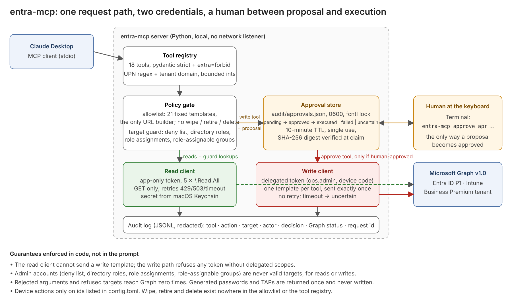

# entra-mcp

An approval-gated [MCP](https://modelcontextprotocol.io) server that lets an AI client (Claude Desktop) answer help-desk
questions from a live Microsoft Entra ID + Intune tenant over Microsoft Graph v1.0: is this user enabled, when did
they last sign in, what groups and MFA methods do they have, what did their recent sign-ins look like, what devices
do they own.

[](https://github.com/sagarmodha9-dotcom/entra-mcp/actions/workflows/tests.yml)

**For a reviewer in a hurry:** [what it does](#tools) · [how a write happens](#how-a-write-happens) · [security design](#security-design) ·
[what is live-tested vs simulated](#evidence) ([EVIDENCE.md](EVIDENCE.md), [ACCEPTANCE.md](ACCEPTANCE.md)) · [demo](#demo-simulated-2-minutes) ·
[setup](#setup-15-minutes). Nothing in this README claims a tool works unless the evidence file recorded it.

**Seven read tools (milestone 1), plus an approval-gated write path (milestones 2–4): 2 approval tools, 7
identity writes, 2 device actions; 18 tools in total.** Every request goes through one path: MCP client → tool
registry (strict schemas) → policy gate (endpoint allowlist + target guard) → Graph client → audit log. There is
no tool that takes a URL, a Graph path or a query string, and no tool can wipe, retire or delete anything.

Status: see `EVIDENCE.md`, which is written only by the live test scripts and prints its own "N of M tools
live-validated" line. Nothing in this README claims a tool works unless that file recorded it. The full status by
category (implemented / mock-tested / live-tested / pending / blocked), the remaining blockers and the release
checklist are in `ACCEPTANCE.md`. A ten-minute walkthrough of what a reviewer sees is in `DEMO.md`.



<sub>Also as SVG: [docs/architecture.svg](docs/architecture.svg)</sub>

## Demo (simulated, 2 minutes)


**Everything in this recording is simulated.** It runs the real server code (schemas, allowlist, target guard,
approval store, write engine, audit log) against the in-repo fake Graph transport, on a fictional tenant
(`00000000-…`, `contoso-demo.onmicrosoft.com`, invented users). No network, no credentials, no live Microsoft
operation. The twelve steps: a read, a rejected hostile argument, a **denied** write against an admin, a proposal,
the AI's own `approve` call refused, a **human** approving in Terminal (simulated by calling the same function
the CLI calls, and labelled as such), the approved execution, a replay refused, and the redacted audit trail.
Intune device actions are deliberately not shown: they are mock-tested and pending a disposable enrolled device.

Reproduce it: `python demo/run_demo.py` (writes `demo/transcript.json` from a fresh run) then `python demo/record.py`
(builds the self-contained `demo/demo.html`, records it with Playwright, encodes `docs/demo.mp4` and `docs/demo.gif`).
Needs `pip install -e ".[demo]"`, `python -m playwright install chromium` once, and ffmpeg on PATH. Without them,
open `demo/demo.html` in a browser: it plays itself. Verified from a clean checkout and a fresh virtualenv: identical
12-step transcript, 109 tests, playable 2:01 video.

## How a write happens

```
model calls disable_account(upn, reason)
   -> server validates, runs the target guard with the READ credential, stores a PROPOSAL, returns apr_<id>
   -> nothing has changed
human runs in Terminal:  entra-mcp approve apr_<id>          (or: entra-mcp deny apr_<id>)
model calls approve(apr_<id>)
   -> server re-checks the target, executes ONE allowlisted Graph call with the operator's DELEGATED token,
      verifies with a read, records the result; the proposal is now spent
```

The model can propose and can execute, but only a person at the keyboard can turn a proposal into an approved
one. Proposals expire after 10 minutes and are single use. Generated passwords and Temporary Access Passes are
returned once in the tool result and never written to the audit log or the approval store.

Two credentials, never mixed: reads and the guard use the `entra-mcp-readonly` app (application permissions,
client secret in the Keychain). Writes use the `entra-mcp-writes` app (delegated permissions only) with a token
from `entra-mcp login` (device-code flow) cached under `~/Library/Application Support/entra-mcp/` with mode 0600.
The read client cannot send a write template; the write path refuses any token without delegated scopes.

Operator roles (least privilege, verified on Microsoft Learn's "least privileged roles by task"): **User
Administrator** (enable/disable, reset non-admin passwords, revoke sessions, group membership) and
**Authentication Administrator** (Temporary Access Pass). The operator account is itself on the deny list.

Out of scope by design: wipe, retire, delete, password-profile edits, role or licence changes, anything on an
admin account, any device not listed in `config.toml` `test_device_ids`.

## Tools

| tool | what it answers | Graph endpoint (fixed) |
|---|---|---|
| `get_user` | enabled? title, department, created, last password change | `GET /users/{upn}?$select=…` |
| `get_last_sign_in` | last interactive / non-interactive sign-in (P1) | `GET /users/{id}?$select=signInActivity` + list-form cross-check |
| `list_user_groups` | direct group and role memberships | `GET /users/{id}/memberOf` |
| `list_auth_methods` | registered MFA methods (phone masked, no ids) | `GET /users/{id}/authentication/methods` |
| `get_sign_in_logs` | recent sign-ins with success/failure codes, 1–30 days | `GET /auditLogs/signIns?$filter=userId eq '{id}' and createdDateTime ge …` |
| `list_devices` | Intune devices, optionally by primary user | `GET /deviceManagement/managedDevices` |
| `get_device` | one Intune device: OS, compliance, last sync | `GET /deviceManagement/managedDevices/{id}` |

Things Graph cannot do, stated in the tool descriptions rather than papered over:

- There is no "locked out" flag and no unlock API. Entra smart lockout clears itself (60 s, growing); `get_user`
  says so and points to `get_sign_in_logs` for failed attempts.
- `signInActivity` returns 204 / nothing for a user Graph has no value for, and Microsoft documents the property
  as updating **up to 24 hours** after a sign-in. The server does **not** turn that into "never signed in": it
  re-queries the documented list form and returns `status: unknown` with the reason and a pointer to
  `get_sign_in_logs`. `status: unavailable` is returned when the tenant lacks P1 / the permission (403).
  Observed live: Alice's sign-ins were visible in the sign-in log within minutes while `signInActivity` was still
  empty two hours later.
- `auditLogs/signIns` filtered by user is slow and occasionally stalls: 9–19 s per call on this tenant, with a
  30 s timeout on roughly one call in three across the recorded runs (one run saw none after the server stopped
  sending a `ConsistencyLevel: eventual` header; the next run saw one again, so the header was not the whole
  story), and one 61 s outlier in the next-day run. This template has its own budget (20 s per attempt, one
  retry), and every tool call runs under a hard 40 s wall-clock deadline (`limits.tool_deadline_seconds`) that
  covers all its Graph requests and retries: a stall becomes `status: unavailable` with a reason, never a hang.
  Measured after the budget, before the deadline: 17.4 / 12.8 / 10.7 s and 17.4 / 41.3 / 17.1 s (the 41 s call
  was one 20 s stall plus a successful retry). The tool description tells the model to expect the wait. Logs are
  kept 30 days on Entra ID P1.
- `signInActivity` reads occasionally stall (2 of 20 calls in each recorded run) and succeed on retry; p50 stays
  around 1 s. The per-request timeout is 10 s and the 40 s tool deadline caps the retry loop. A live run with the
  10 s timeout active still showed two 31 s calls, which places the stall outside the socket (name resolution is
  not covered by `requests.timeout`); the transport therefore runs each call in a worker thread and abandons it
  at the wall-clock bound, and uses one pooled session so lookups are rare. Layer T proves both bounds without
  real waiting; the live effect is recorded in `tests/live_results.md` once re-measured.

## Security design

- **Read-only by construction.** The app registration has five application permissions, all `*.Read.All`. The
  token's `roles` claim is checked at test time for any write scope (B5). `GraphClient` has one method, `get`.
- **Allowlist, not a filter.** `allowlist.py` holds ten `(GET, path template, fixed query)` entries. Values are
  typed (UPN, GUID, ISO timestamp, int 1–50), validated, and URL-encoded with no safe characters; `$filter`
  strings are built from the resolved GUID, never from user input.
- **Target guard, fail closed.** Before any tool touches a user: deny list from `config.toml` (zero Graph calls),
  then `transitiveMemberOf/directoryRole`, `roleManagement/directory/roleAssignments` (scoped and PIM roles) and
  role-assignable group membership. Any non-200 refuses. Admin accounts are never a valid target, even for reads.
- **Strict schemas.** pydantic `extra="forbid"`, `strict=True`; UPN regex plus tenant-domain check; `days` 1–30,
  `top` 1–50. Rejections never reach Graph.
- **Secrets.** Client secret from the macOS Keychain (`security find-generic-password`) or `ENTRA_CLIENT_SECRET`
  in CI. Never in config, logs, errors or results: every string written passes a redaction filter (JWTs, secret
  shapes, the registered secret value, phone numbers, IPs), and a repo grep test fails on a match.
- **Audit.** One JSONL line per call, including refusals and invalid arguments: `ts, tool, args, target,
  decision, graph_status, graph_calls, latency_ms, request_id, error`. Results are never logged. `audit/` is
  gitignored; a placeholder sample is in `tests/live_results.md`.
- **Prompt injection.** Tool results are data. The server has no capability to act on them, no "everyone" tool,
  and no second request can be triggered by content (B2). What the *model* does with hostile data is measured
  separately (layer D, roadmap) and reported as a number.

## Trust boundary and known risks

Stated plainly so nobody reads more into the approval flow than it provides.

- **The approval gate is a file, not a signature.** `audit/approvals.json` (mode 0600) is the record a human
  approved; `entra-mcp approve` writes it, the server reads it under an exclusive `fcntl` lock so two processes
  cannot both claim one proposal, and a SHA-256 digest set at proposal time is verified before execution so an
  edited proposal is refused and denied. Anything running as the same macOS user could still forge an approval.
  The boundary is "a person at this keyboard", which is the design goal for a single-operator help-desk tool, not
  a multi-tenant authorization system.
- **Writes are sent exactly once.** The write client has no retry loop. A Graph 4xx/5xx marks the proposal
  `failed`; a timeout with no response marks it `uncertain` and tells the caller to verify with a read. Both
  spend the proposal. This avoids double-applying non-idempotent calls (TAP creation, password reset) at the cost
  of occasionally asking the operator to look before retrying.
- **Delegated token cache on disk.** `~/Library/Application Support/entra-mcp/msal_cache.bin` (mode 0600) holds
  the operator's refresh token. Whoever can read it can act as ops.admin until `entra-mcp logout` or the token
  is revoked in Entra. Treat the Mac's user account as the credential.
- **Verification reads lag writes.** Graph directory reads were observed to return the pre-write value for a few
  seconds after a 204. Read-backs poll for up to 15 s; a verification can still report stale state under heavy
  replication lag, and the audit line records what was observed, not what was assumed.
- **Model behaviour is not a server guarantee.** Claude Desktop, after a revoke, offered "remotely locking the
  device in Intune", a capability this server does not have. The server refuses what it cannot do; the model's
  suggestions are the layer-D measurement, reported separately.
- **Test-user secrets that reach a terminal get pasted.** The live scripts now mask generated passwords and TAPs
  unless `--show-secrets` is passed. Two of Carol's temporary passwords and one TAP were exposed through pasted
  output during development; the password was reset again and the TAP deleted afterwards.

## Release hygiene

`scripts/scan_history.sh` scans every commit in the published history for the values that were once pasted into a chat, for secret shapes (client secrets, JWTs, private keys, MSAL cache), and for files that must never have been tracked; `tests/verify_cleanup.py` proves, read-only, that the exposed test credentials are dead. Both results are recorded in `ACCEPTANCE.md` §3.

## Evidence

Three layers, three files, never mixed:

| layer | what it proves | file | how it runs |
|---|---|---|---|
| A protocol, B server authorization, W write path | the server's own behaviour (88 tests) | `tests/unit_results.md` | `pytest`, Graph mocked, no tenant |
| C live tenant (+ live B1/B3/B5/B6) | real Graph behaviour for each read tool | `tests/live_results.md`, `EVIDENCE.md` | `python tests/live_m1.py` against the trial tenant |
| M2–M4 live tenant | approvals, every write with a verification read, device refusals | `tests/live_results_m23.md`, `EVIDENCE.md` | `python tests/live_m23.py` (interactive: you approve each write in the Terminal) |
| Claude Desktop end to end | a read question (C10) and a full write flow (W-E2E) through the real client | rows in the two files above | `python tests/record_c10.py`, which reads the server's own audit log |
| tenant prerequisites | licences, permissions, write refusal by Graph | `tests/live_results_validate.md` | `python tests/validate_tenant.py` |

Rows in `EVIDENCE.md` are written only by the live script. "Pending" means a precondition is not met yet (test
user has not signed in, no dedicated test device enrolled), not that code is missing.

Tenant: Microsoft 365 Business Premium trial (Entra ID P1 + Intune Plan 1, no P2), three fictional cloud-only
users (alice.test, bob.test, carol.test), two security groups. Device rows stay pending until a dedicated,
disposable test device is enrolled; the everyday Mac is never used for device tests.

## CLI

```
entra-mcp --check                 # config, Keychain secret, tool count
entra-mcp login                   # operator device-code sign-in (write path)
entra-mcp whoami                  # who is signed in for writes
entra-mcp logout                  # delete the operator token cache
entra-mcp approvals               # proposals and their status
entra-mcp approve apr_<id>        # the human step
entra-mcp deny apr_<id>
```

## Setup (15 minutes)

1. App registration (single tenant): application permissions `User.Read.All`, `Directory.Read.All`,
   `UserAuthenticationMethod.Read.All`, `AuditLog.Read.All`, `DeviceManagementManagedDevices.Read.All`; grant
   admin consent; create a client secret.
2. Secret into the Keychain (never paste it anywhere else):
   `security add-generic-password -U -s entra-mcp-readonly -a <you> -w '<secret>'`
3. `cp config.example.toml config.toml` and fill in tenant id, client ids, tenant domain, Keychain account and protected UPNs
   (your admins). `config.toml` is gitignored: it identifies a real tenant, so it never enters the repository; the test suite
   uses `tests/fixtures/config.test.toml` (a fictional tenant) and needs no tenant at all.
4. Install and check:
   ```
   python3.12 -m venv .venv && source .venv/bin/activate
   pip install -e ".[test]"
   entra-mcp --check          # config ok, secret ok, 7 tools
   pytest                     # 109 mocked tests (layers A, B, T, W), fictional tenant, no network
   python tests/live_m1.py    # layer C against your tenant
   ```
5. Claude Desktop → Settings → Developer → Edit Config, add:
   ```json
   {
     "mcpServers": {
       "entra-mcp": {
         "command": "/Users/<you>/entra-mcp/.venv/bin/entra-mcp",
         "args": ["--config", "/Users/<you>/entra-mcp/config.toml"]
       }
     }
   }
   ```
   Restart Claude Desktop; the seven tools appear under the tools icon.

## Layout

```
src/entra_mcp/
  schemas.py      tool argument models (extra=forbid, strict), UPN + GUID validation
  allowlist.py    the only URL builder: ten fixed GET templates
  guard.py        target guard (deny list, directory roles, role assignments, role-assignable groups)
  graph.py        MSAL app-only token, GET with retries, error mapping, injectable transport
  tools.py        the seven tools + Engine.run (validate -> guard -> GET -> shape -> audit)
  audit.py        append-only JSONL, redacted
  redact.py       redaction filter
  keychain.py     client secret lookup
  server.py       MCP over stdio (mcp 2.x low-level Server), static no-generic-tool check
  faketransport.py HTTP mock used by layers A/B and the stdio handshake test
tests/
  test_a_protocol.py        A1-A7      test_b_authorization.py   B1-B6
  live_m1.py                C1-C10 + live B1/B3/B5/B6, writes live_results.md and EVIDENCE.md
  validate_tenant.py        tenant prerequisites and Graph-side write refusal
```

## Roadmap

Milestone 2: second app registration (delegated, device-code flow), approval objects with TTL, `approve` and
`list_pending_approvals`. Milestone 3: identity writes behind approvals (disable/enable, reset password, TAP,
revoke sessions, group add/remove). Milestone 4: Intune `sync_device` and `reboot_device` on listed test devices
only; wipe and retire are never registered as tools. Each milestone gets its own permissions, live results and
evidence rows before anything is described as working.
